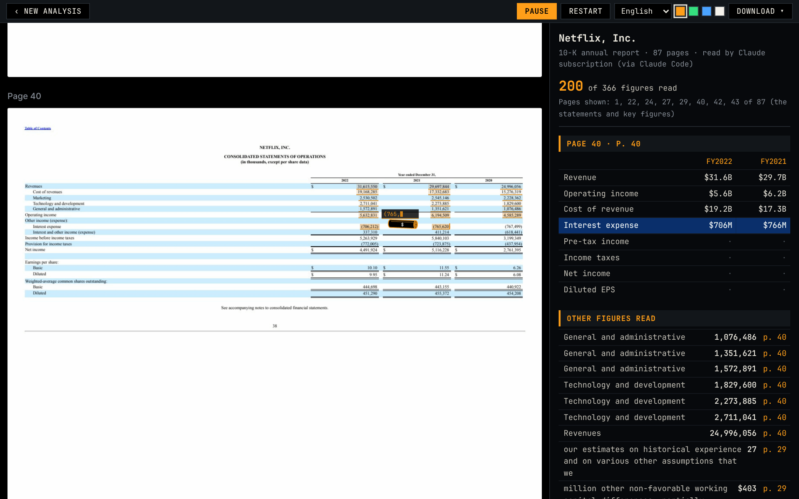
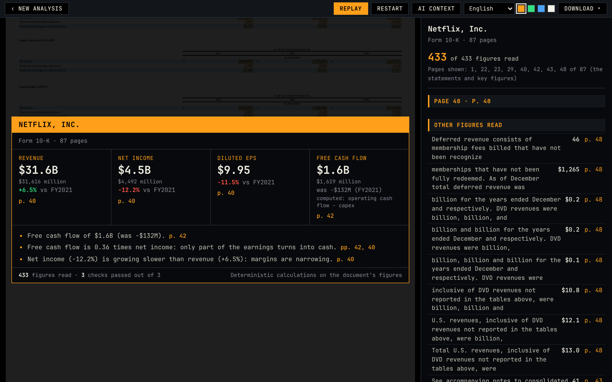
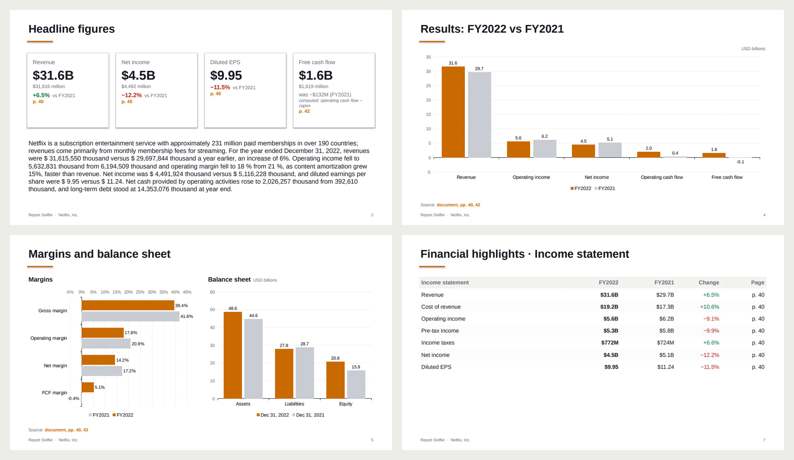

# Report Sniffer

*by AC Quant Lab*

Report Sniffer reads financial documents (10-K, ESEF, PDFs, market data) and builds a live, cited report in a
terminal-style interface. A desktop app with its own window for macOS, Windows and Linux; everything runs on your
computer. Free and open source under the [MIT license](LICENSE).


The sniffer, a small rolled banknote, goes over the original pages of the document and highlights the figures one by
one while the report fills in. **Every figure, check and finding is read and computed by rules** — no AI is needed.
**The AI is optional**: on request it puts an analysis in context, with your own notes and, with Claude or ChatGPT,
the latest news found on the web. Every number it writes about the document is checked against the pages.

**Nine languages** — English, Italiano, Español, Français, Deutsch, Português, Русский, 中文, 日本語 — for the interface
and for every report (in the page, PDF, PowerPoint and Excel). See [Languages](#languages).

## Screenshots

Netflix's 2022 10-K (FinanceBench PDF), read by rules, with no AI connected.

| | |
|---|---|
|  |  |
| **Reading** — every figure is highlighted where it is printed on the original page and lands in the report with its page. | **The card** — headline figures, findings and checks, each citing its page. |
|  |  |
| **Search** — annual reports, quarterly reports and earlier years, to analyse or download. | **PowerPoint** — editable charts and tables, every slide names its source pages. |


**PDF report** — the same analysis on paper; the figures are also downloadable as an Excel workbook.

## Download

Get the app for your system from the [latest release](../../releases/latest), unpack it and double-click it.
No Python and no terminal are needed.

| System | File | Start |
|---|---|---|
| Windows 10/11 (64-bit) | `ReportSniffer-windows-x64.zip` | unpack, open the `ReportSniffer` folder, double-click `ReportSniffer.exe` |
| macOS (Apple silicon) | `ReportSniffer-macos-arm64.zip` | unpack, move `Report Sniffer.app` to Applications, double-click it |
| Linux (x86-64, glibc 2.39+) | `ReportSniffer-linux-x64.tar.gz` | unpack, run `ReportSniffer/ReportSniffer` |

The app opens in **its own window**, like any desktop program; closing the window quits it. The window uses the web
view of the system: Microsoft Edge WebView2 on Windows (part of Windows 10 and 11), WebKit on macOS (the engine of
Safari), Qt WebEngine on Linux (bundled). No AI is needed to start: connect one in **Settings** whenever you want the
[AI context](#the-ai-optional-context-and-news). Starting the app again while it runs opens one more window. What it
would print goes to `~/.report-sniffer/app.log`. When a new version is published, the home page says so and
**Update now** installs it — see [Updates](#updates).

If the system cannot show the window (Windows without WebView2; Linux without a display or without the X11 libraries
Qt needs, such as `libxcb-cursor0` and `libxkbcommon-x11-0`), the app opens `http://127.0.0.1:8765` in a
Chromium-based browser instead, and stops from **Quit** in the bottom bar of the home page.

- The builds are **not code-signed**. On macOS the first start is blocked ("cannot be verified"): go to
  *System Settings → Privacy & Security* and click *Open Anyway*. Windows shows "Windows protected your PC":
  click *More info → Run anyway*.
- Intel Macs and other systems: run it from the source (below).
- The Linux download is larger (about 250 MB packed) because it carries Qt WebEngine; Windows and macOS use the web
  view the system already has.
- The apps are built by GitHub Actions (`.github/workflows/build.yml`) whenever a tag `v…` is pushed.

## Requirements

- macOS, Windows 10/11 or Linux. Nothing else: the window uses the system's web view (see [Download](#download)).
  Only when that is missing does the page open in a browser, and then it must be a Chromium-based one (Chrome, Brave,
  Edge, Arc, Vivaldi, Opera); the reading in a browser tab is tested with Chromium only.
- **An AI is optional**: your Claude Pro/Max or ChatGPT subscription, or an API key, for the
  [AI context](#the-ai-optional-context-and-news).
- Only to run from the source: **Python 3.10 or newer** — [python.org/downloads](https://www.python.org/downloads/)
  (on Windows tick *Add python.exe to PATH*; on a Mac `brew install python` also works).

## Run from the source

| System | Double-click | Or from a terminal, in the project folder |
|---|---|---|
| macOS / Linux | `Start Report Sniffer.command` | `python3 launch.py` |
| Windows | `Start Report Sniffer.bat` | `py launch.py` |

The first start creates a virtual environment (`.venv`), installs the dependencies (1–2 minutes; on Linux also Qt
WebEngine, about 200 MB, unless PyGObject with WebKitGTK is installed) and asks for a name and email to identify
yourself to the SEC (optional). Then the app opens in its own window. Close the window (or the terminal window, or
press Ctrl+C) to stop it.

- **macOS blocks the double-click** ("cannot be verified"): use `python3 launch.py` from Terminal, or go to
  *System Settings → Privacy & Security*, click *Open Anyway* at the bottom and try again.
- **Windows shows "Windows protected your PC"**: click *More info → Run anyway*, or use `py launch.py`.
- Options (also for the downloaded app): `SNIFFER_PORT=9000` changes the port, `SNIFFER_LANG=de` (or any [language](#languages) code) forces the interface language, `--no-window` starts only the server (open
  `http://127.0.0.1:8765` in a Chromium browser yourself), `SNIFFER_BROWSER="Brave Browser"` (macOS app name, or an
  executable path elsewhere) chooses the browser used when no window can be shown.
- To build the app yourself: `pip install -r requirements.txt pyinstaller`, then
  `pyinstaller --noconfirm packaging/report_sniffer.spec` (the result is in `dist/`).

## What it reads

| You look for | The document that is read | Source |
|---|---|---|
| US-listed companies (MSFT, NVDA, …) | Latest 10-K, 20-F or 40-F in inline XBRL; under *Other documents* the quarterly reports (10-Q), results releases (8-K item 2.02, read from exhibit 99.1), prospectuses and earlier years | SEC EDGAR |
| Companies before an IPO (no ticker yet) | Latest S-1, F-1 or 424B prospectus (tagged or not) | SEC EDGAR full-text search |
| European companies (Ferrari, ENI, …) | ESEF annual report in inline XBRL; earlier years under *Other documents* | filings.xbrl.org |
| Crypto, indices, currencies, commodities, ETFs, funds (BTC-USD, ^GSPC, EURUSD=X, GC=F, …) | A generated market sheet: chart, calendar-year and monthly returns, volatility, drawdowns | Yahoo Finance (Coinbase as fallback for crypto) |
| Any other document: annual report or statements as PDF/HTML, KID, prospectus, factsheet, whitepaper (statement lines are recognised by rule in English and Italian; in other languages the figures are still read and highlighted, with fewer statement lines recognised) | The file you upload (*Upload a document*) or the URL you paste | Your file / URL |

**Not in the search** (the home page says so too): Italian half-year reports and other documents not filed in ESEF, accounts of
unlisted companies (business register), fund KIDs and factsheets — upload the PDF or paste its address.

Companies without a ticker are found through EDGAR full-text search among the filers of prospectuses and annual
reports. Each search result offers two actions: **Analyse** (the document is read) or **Download original** — the filing as
published on SEC EDGAR (`.htm`), the ESEF report from filings.xbrl.org (`.xhtml`), or for market instruments the
daily price history as CSV.

In inline XBRL filings every figure is an XBRL tag, so its value and exact position are known — no guessing.
In untagged PDF/HTML the figures are the ones printed on the page:

- **Pages**: HTML filings are split into their printed pages — page breaks, or the fixed-size page boxes of EDGAR's
  PDF-to-HTML renderings (an S-1 of 400+ pages included); EDGAR submission envelopes (`<DOCUMENT><TYPE>S-1…`) are
  removed. Citations use the page numbers printed on the page ("p. 22", "p. F-7").
- **Tables**: statement tables are read as tables: every cell gets its row and its column, and the column header
  gives the period — "Year Ended December 31, 2025", "Six Months Ended June 30, 2026", "As of June 30, 2026";
  "$ Change", "% Change", "Pro Forma" and "As Adjusted" columns are left out, percentage-of-revenue tables are
  marked as percentages, the scale comes from "(in millions…)" (share counts "in thousands" too).
- **Periods**: the current period is the latest one (an interim period when there is one) and it is compared with
  the same period a year earlier; balance sheet items with the latest date and the previous year end. The same line
  printed in the summary, the MD&A and the statements is counted once.
- **Rows**: Revenue / Ricavi, Net income or Net loss / Utile netto, "Net loss per share…, basic and diluted",
  Operating loss, Loss before provision for income taxes, Total operating expenses, Redeemable convertible preferred
  stock, Total stockholders' deficit, Net cash provided by (used in) operating / investing / financing activities,
  Purchases of property and equipment, Net increase in cash…
- **Not figures**: days in dates ("June 30"), footnote marks ("Net loss(2)", "(Note 13)"), par values, phone
  numbers and ZIP codes are skipped.
- In PDFs the rows are recognised from their labels on the page with the column periods and scale: years in either
  order (2022 2023 2024 or the reverse), quarter codes (1Q23 vs 1Q22), "Three Months Ended", "Thirteen Weeks Ended",
  "Second Quarter", dates printed on a line of their own; note-reference and "% to sales" columns are left out, labels
  wrapped onto two lines are joined, the consolidated statements win over the parent-company, guarantor and quarterly
  ones, over an investee's statements for older years and over segment and MD&A tables; a statement carried over to the
  next page keeps its scale and columns; each figure goes under the column header it sits under (an empty cell stays
  empty: no shift of the years); a total printed without a label closes its section ("Total assets"); EPS
  under "Basic" / "Diluted" headings, tax lines whose wording gives their sign ("Benefit from (provision for) income
  taxes") and titles that the PDF prints with broken words ("Balance Shee t") are read too.
- **Scans and unreadable text**: a page without real text — a scan, a table pasted as a picture, or a PDF whose
  fonts map their letters to other codes (McDonald's earnings releases: "!0+"!b#$") — is read with optical character
  recognition: [RapidOCR](https://github.com/RapidAI/RapidOCR) with the PP-OCR models, on your computer and offline,
  about 1–3 seconds a page. Its words get their place on the page, so the figures are read and highlighted as in any PDF.
- **Banks and insurers**: net interest and other banking income, total net revenue, insurance revenue (IFRS 17) count
  as revenue; free cash flow is not computed for them (capex means little for a bank's cash flow statement).
- **ESEF reports** laid out with page containers (`pf`, `page…` classes, nested) or with no pages at all (the text
  is cut into pages at headings) are split too; issuer-specific concepts are recognised by the label of their row.

## Accuracy

How many figures read from an untagged PDF are right is measured, not guessed: `bench/accuracy.py` reads the 269
annual reports (10-K PDFs, 2015–2023, 32 US companies from tech to banks, utilities and retail) of
[FinanceBench](https://github.com/patronus-ai/financebench) by rules, with no AI, and compares every statement
figure it reads — revenue, operating income, pre-tax income, taxes, net income, diluted EPS, cash, current and total
assets and liabilities, equity, operating/investing/financing cash flows, capex and more, for the current and the prior
year — with the value the company filed in XBRL with the SEC for the same period in the same 10-K
([data.sec.gov companyfacts](https://www.sec.gov/search-filings/edgar-application-programming-interfaces)).

| On the 269 10-K PDFs | v2.1.0 | v2.2.3 |
|---|---|---|
| Figures read that equal the filed value | 93.8% (627 wrong) | **100%** (11,787 of 11,787) |
| Main lines (16 lines × 2 years) found, of those the statements print | 78.8% | **100%** (8,214 of 8,214) |

| On the 56 quarterly reports (10-Q) and earnings releases | v2.1.0 | v2.2.3 |
|---|---|---|
| Figures read that equal the filed value | 97.5% (41 wrong) | **100%** (1,939 of 1,939) |
| Main lines found, of those the statements print | 82.2% | **100%** (1,353 of 1,353) |

| Scanned documents: the 29 earnings releases read **only with OCR**, as if they were scans | v2.2.3 |
|---|---|
| Figures read that equal the filed value | **100%** (819 of 819: the same figures as from their text) |
| Main lines found, of those the statements print | **100%** (567 of 567) |

The rules were first fixed on the 40 latest reports; on the other years, which they had not seen, they then read
96.6% (2019) and 98.4% (2015–2021) right, and what was still wrong there was fixed in turn. So 100% means "no
error left on these documents", not "no error possible": another layout can still leave a line unread or, rarely,
read one from the wrong place. Lines a statement does not print (MGM has no "Total liabilities" row) are not counted
as missed. The page of every figure is shown, so it can be checked. Inline XBRL filings need no such measure: their
figures are the tags themselves.

Quarterly figures are compared with the 10-Q (or, for a fourth quarter, the 10-K) of the same period: the quarter, the
year to date, and a quarter that nobody filed on its own (the fourth, a cash flow quarter) as the difference of two
filed year-to-date figures. Earnings releases often print no balance sheet or cash flow statement; two 8-Ks of PG&E
have no statements at all. McDonald's releases, whose text layer is glyph codes, are read with OCR (Q4 2022: 32 figures,
none wrong). For the OCR measure every page is read as a picture (`FORCE_OCR=1`), at 144 dpi, without the PDF's
text.

**European reports in PDF are read less well than US ones.** `bench/esef.py` prints ESEF annual reports of European
companies (filings.xbrl.org, English versions) to PDF, reads them like any untagged PDF and compares each figure with
the value the same report tags. On 32 reports from 13 countries: 568 of 574 figures right (99.0%; v2.2.4: 423 of 462; v2.2.3: 64%). Read
now: scales such as "DKKm", "EUR '000", "TEUR"; amounts with spaces between thousands ("197 034") or broken by the PDF;
decimal commas; dates such as "31.12.2023"; "Note" columns; the group's statements rather than the parent company's.
Still wrong: some reports whose group and parent statements look alike. Check European figures against their page.
(An ESEF report searched in the app is read from its tags, not by these rules.)

```
SNIFFER_SEC_UA="Your Name you@example.com" .venv/bin/python bench/accuracy.py 2019 2020   # or: latest, quarterly, APPLE_2022_10K
FORCE_OCR=1 SNIFFER_SEC_UA="…" .venv/bin/python bench/accuracy.py quarterly PEPSICO_2023Q2_EARNINGS     # read as a scan
.venv/bin/python bench/esef.py 3 2023-12-31     # European reports: 3 per country (needs Node with Playwright)
```

## Report

- **AI context** (optional, see [below](#the-ai-optional-context-and-news)): the kind of document, a short summary,
  key points by theme (results in context, what the news changes, risks, your questions…) with their pages, your
  notes, and the latest news with its link — in the side panel, the PDF, the slides and the workbook.
- **Card (financial statements)**: revenue, net income (or net loss), diluted EPS, free cash flow (operating cash flow −
  capex, marked as computed), each with the exact amount, the change against the comparative period ("+1,300% vs
  H1 2025") — or the comparative value when a loss makes a percentage meaningless — and the page.
- **Arithmetic checks**, only those the figures allow: revenue − operating expenses = operating income;
  pre-tax income − taxes = net income; assets = liabilities (+ redeemable preferred stock) + equity; diluted EPS ×
  diluted shares ≈ net income; operating + investing + financing cash flows (+ exchange rates, + cash moved to assets
  held for sale) ≈ change in cash; gross profit = revenue − cost of revenue. A gap that other lines explain (amortisation
  between gross profit and costs, an exchange-rate line not read) is shown with its amount and the reason, not as a
  pass. When no check is possible the report says so; it never calls figures "verified" without a check.
- **Findings**: growth, margins, cash conversion, shareholder returns, interest coverage, debt due vs cash,
  liquidity, leverage — deterministic calculations on the document's figures.
- **Language**: any of the [nine languages](#languages), chosen on the home page or while reading (the report is
  regenerated: findings, checks, labels, periods, number formats — `$120B`, `$120 mld`, `$120 Mrd.`, `$1,200亿`; the
  AI context is asked for again in the new language).
- **Download** (menu in the reading view): *Report (PDF)*; *Slides (PowerPoint)* — a 16:9 deck with native, editable charts,
  every slide citing the printed pages and the source; *Figures (Excel)* — statements as numbers with unit and page, changes
  and free cash flow as formulas, ratios, checks, every figure read (prices and returns for market sheets).
  The PDF is drawn on white, with the accent colour of the chosen theme, by the local server
  in a fraction of a second (no browser involved). Names and texts in Latin, Greek, Cyrillic, Chinese, Japanese and
  Korean script are printed as they are (the fonts are embedded). No pages of raw figures: it holds
  - the summary card, the key findings and, when asked for, the AI's summary;
  - **financial highlights**: income statement, balance sheet and cash flows with the two periods compared, the change
    and the page of each line;
  - charts: revenue and net income over every period the document prints (years, then the latest interim pair),
    results against the comparative period, margins, balance sheet (side by side when there is a deficit or
    redeemable preferred stock), where the operating cash goes; for market sheets the price chart, calendar-year
    returns, drawdown and the monthly-returns heatmap;
  - the AI context section by section with the news and its links (when asked for), key ratios, the arithmetic
    checks with their pages, and how the document was read (pages shown, periods compared, what the AI read).
- **Themes**: Terminal (amber on black, the default), Phosphor (green), Desk (blue) and Paper (light) — the swatches
  in the bottom bar of the home page and in the reading bar change the interface, the sniffer, the highlights and
  the accent colour of the PDF and the slides; the choice is remembered by the app.

## The sniffer

A small rolled banknote lying on its side, drawn with a few thin lines. It moves over **the original document** — the
page images of a PDF, the filing's own HTML pages — and its nose stops at the left edge of each figure, on its line,
lighting up while it reads. Nothing is written next to the roll: the figure is selected where it is printed, as in a
terminal — the highlight steps over it one character at a time behind a caret — and then **stays highlighted**, with
an underline (stronger for the headline figures), so every figure read remains marked on the page. Headings are
selected the same way in the second colour. The roll glides from figure to figure with eased movements, left to right
and down the page; there are no boxes and nothing flashes.

It always reads **every** figure on the pages it opens and adapts its pace to how many there are (about
7 seconds for a short document, up to about 35 seconds for a long one); the headline figures (revenue, net income,
EPS, operating cash flow) stay selected for at least half a second, however fast it goes. The "N of M figures read" counter counts
the figures on those pages, and the panel lists which pages of the document were read (the cover and the pages
with the financial statements and the key figures).

## Languages

| Code | Language | Numbers | Amounts | Dates |
|---|---|---|---|---|
| `en` | English | 1,234.5 | $16.3B | Jun 30, 2026 |
| `it` | Italiano | 1.234,5 | $16,3 mld | 30 giu 2026 |
| `es` | Español | 1.234,5 | $16,3 mil M | 30 jun 2026 |
| `fr` | Français | 1 234,5 | $16,3 Md | 30 juin 2026 |
| `de` | Deutsch | 1.234,5 | $16,3 Mrd. | 30. Juni 2026 |
| `pt` | Português (Brasil) | 1.234,5 | $16,3 bi | 30 jun 2026 |
| `ru` | Русский | 1 234,5 | $16,3 млрд | 30 июн. 2026 |
| `zh` | 中文（简体） | 1,234.5 | $163亿 | 2026年6月30日 |
| `ja` | 日本語 | 1,234.5 | $163億 | 2026年6月30日 |

- **Interface**: the *Interface* menu in the bottom bar of the home page (remembered by the app); by default the
  operating system's language when it is one of these, else English. The app's messages (progress, errors) follow it.
- **Report**: the *Report language* menu on the home page or in the reading bar. Everything the report says is in that
  language: the page, the PDF, the slides and the workbook use its words, periods (`FY2025`, `Esercizio 2025`,
  `GJ 2025`, `2025财年`…), number and date formats, and the AI context is written in it. Figures quoted from the
  document stay as printed.
- The PDF embeds fonts for Latin, Greek, Cyrillic, Chinese, Japanese and Korean, so names in those scripts are printed
  whatever the report language. Arabic and Hindi are not offered: the PDF cannot lay out right-to-left or joined
  scripts.
- The translations (`analyst/locales/*.json`, `web/i18n.js`) were written with an AI and checked by tests for
  completeness and placeholders, not by native speakers: corrections are welcome. A text added to the code in Italian
  and English must be added to every catalog (`tests/test_i18n.py` fails until it is).

## The AI (optional): context and news

Report Sniffer reads every figure, runs every check and writes every finding by rules, with no AI. When you want more,
press **AI context** in the reading bar: you can add your own notes (what you want to know, your view, what to compare)
and, if the AI in use can search the web, ask for the latest news. The AI gets:

- the figures Report Sniffer read (headline figures, statements, ratios and changes) and the findings computed from them;
- the text of the pages — all of them when they fit in about 65k tokens, otherwise the cover, the summary sections
  (prospectus summary, risk factors, MD&A…), the statements and the pages densest with figures;
- your notes;

and returns the kind of document, a summary, key points by theme and the news it found. It runs while the reading goes
on; the result appears in the side panel and in the PDF, slides and workbook, and stays with the analysis.

**What is checked.** A sentence is kept only if each of its numbers is printed in the pages read, among the figures
Report Sniffer gave it or in your notes — or in the news item it cites. A news item is kept only with its web address;
with the Claude API, only an address its web search actually returned. News is shown as found, with its source and
link: Report Sniffer does not verify what the articles say. The figures, card, checks and charts never come from the AI.

**Where the news comes from.**

| AI | Web search |
|---|---|
| Claude, API key | Anthropic's web search tool, at most 6 searches per request (billed by Anthropic: $10 per 1,000 searches plus tokens — [docs](https://platform.claude.com/docs/en/agents-and-tools/tool-use/web-search-tool)) |
| Claude subscription (Claude Code) | Claude Code's own *WebSearch* and *WebFetch* tools, the only tools it is given |
| ChatGPT subscription (Codex) | Codex's live web search (`web_search = "live"`), in a read-only sandbox |
| OpenAI, Gemini, Mistral, xAI, DeepSeek, OpenRouter (API keys) | none from Report Sniffer: context from your notes and the document only, no news |

Connect the AI in **Settings** (the *AI: off* label at the top right of the home page opens them too). Two ways:

**A subscription you already have.** Report Sniffer runs the vendor's official command-line tool, which you install
and sign in to yourself; the app never sees or stores your credentials, and the usage counts toward your plan's limits.

| Subscription | Tool | Set up once |
|---|---|---|
| Claude Pro / Max | [Claude Code](https://claude.com/product/claude-code) | install it, run `claude`, sign in with your Claude account |
| ChatGPT Plus / Pro | [Codex CLI](https://github.com/openai/codex) | `npm install -g @openai/codex`, run `codex`, choose *Sign in with ChatGPT* |

The tool runs in an empty folder and must return JSON that matches the expected schema. Claude Code gets no tools
(`--tools ""`), or only its web search and web fetch when news is asked for, and no MCP servers (`--strict-mcp-config`);
Codex runs in a read-only sandbox. The *Model* field takes the tool's own model names (for Claude Code e.g. `sonnet`
or `claude-sonnet-5-5`); empty means the tool's default.

> Terms: Anthropic's [Claude Code legal page](https://code.claude.com/docs/en/legal-and-compliance) says that
> third-party developers may not "route requests through Free, Pro, Max, or Ultra plan credentials on behalf of their
> users", while it does not prevent "an end user from signing in to the unmodified Claude Code binary with their own
> Claude subscription". Report Sniffer does the latter (your own Claude Code, your own account, on your computer); the
> same page notes that plan limits "assume ordinary, individual usage". Whether this kind of use fits your plan is for
> you to judge; for products built on Claude, Anthropic advises an API key. If in doubt, use an API key.

**An API key** (billed by the provider to your account):

| Provider | Default model (editable) | Key from |
|---|---|---|
| Anthropic (Claude) | `claude-opus-5-5` | console.anthropic.com · `ANTHROPIC_API_KEY` |
| OpenAI | `gpt-5` | platform.openai.com · `OPENAI_API_KEY` |
| Google Gemini | `gemini-2.5-pro` | aistudio.google.com · `GEMINI_API_KEY` |
| Mistral | `mistral-large-latest` | console.mistral.ai · `MISTRAL_API_KEY` |
| xAI (Grok) | `grok-4` | console.x.ai · `XAI_API_KEY` |
| DeepSeek | `deepseek-chat` | platform.deepseek.com · `DEEPSEEK_API_KEY` |
| OpenRouter (any model it offers) | `openrouter/auto` | openrouter.ai · `OPENROUTER_API_KEY` |

Keys and the choice of provider are stored in `~/.report-sniffer/ai.json` (readable only by you) or read from the
environment variables above.

## Updates

At every start the app asks GitHub for the latest release (an anonymous request to `api.github.com`, at most every 6
hours). When there is a newer one, the home page shows it, with a link to what is new and **Update now**:

1. the archive for your system is downloaded from the release;
2. its SHA-256 is compared with the digest GitHub publishes for that file: any difference cancels the update;
3. it is unpacked next to the installed app, and the new version must pass its own `--selftest`;
4. the app quits, and a small script swaps the folders — the old version is kept until the new one is in place, and
   put back if the swap fails — then starts the new version.

Nothing changes until step 4, and your data, settings and keys in `~/.report-sniffer/` are never touched. A copy run
from the source, one in a folder it cannot write to (on macOS, an app that was not moved to Applications) and Intel
Macs show **Download** instead, which opens the release page. Versions before 2.1.0 have no updater: download 2.1.0
once by hand.

## Data and privacy

The server listens on `127.0.0.1` only. Documents and responses are cached in `.data/` (in `~/.report-sniffer/data/` by the downloaded app). The SEC identity is in
`~/.report-sniffer/config.json`; the default is generic and no email is sent unless you enter one. The window keeps
its settings (interface language, theme) in `~/.report-sniffer/webview/`. The check for updates sends GitHub nothing
but the app's version (in the User-Agent).

Nothing goes to an AI unless you press **Run** in *AI context*: then the figures, the text of the pages read and your
notes are sent to the provider you chose (or to its command-line tool), under that provider's terms.

### Security

- **Only the app's own page can use the server.** It answers only to localhost names (no DNS rebinding) and refuses
  requests that other websites make the browser send (`Origin` / `Sec-Fetch-Site` headers): a page open in another tab
  cannot start analyses on your AI account, change the settings or stop the app. Every POST must be a JSON object
  (uploads excepted), so plain HTML forms from other sites are refused too.
- **Documents are data, never code.** Filings are shown sanitised (no scripts, frames, forms or event handlers) in a
  sandboxed frame with a strict Content Security Policy; text from documents and search results is escaped in the
  interface; in the Excel export it is always stored as text, never as a formula.
- **API keys** are stored in `~/.report-sniffer/ai.json`, created readable by you only (`0600`), or read from the
  environment variables above. Subscriptions use the vendor's own CLI: the app never sees those credentials.
- **The window** shows only the app's own local page; links to news open in your browser. Files are saved through the
  system's Save dialog. On Linux, where the system forbids Chromium's sandbox to apps without an AppArmor profile
  (Ubuntu 24.04 and later) or when run as root, Qt WebEngine runs without that sandbox; documents are still shown
  sanitised, without scripts, under the Content Security Policy above.

## Known limits

- A document already read is kept in `.data/` (`~/.report-sniffer/data/` for the downloaded app); after an update of Report Sniffer it is read again (the cache key
  includes the version of the reading).
- The AI context takes from a few seconds to a few minutes (longer with web search), and costs what the provider
  charges for up to about 65k input tokens plus the searches (or counts toward your subscription's limits). Each
  report language needs its own context.
- Statement lines in untagged PDFs and HTML are recognised by rule in English and Italian only; in other languages
  the card, checks and charts may have fewer lines (the figures are still read and highlighted).
- Financial figures depend on the issuer's tags: rare or custom concepts may be missing (the card shows "—").
- Documents up to 400 MB (a large ESEF report such as Enel's is 130 MB and takes about 10 s and 700 MB of memory).
  filings.xbrl.org and SEC EDGAR answer "busy" (HTTP 429/503) at times: the app waits and retries three times.
- Untagged PDFs are read from their layout: an unusual layout can leave a line unread or take it from another table;
  a scan is read with OCR, which takes longer (1–3 s a page; a 200-page scan, several minutes) and can misread a blurred
  or skewed page; the page of every figure is shown so it can
  be checked. On 269 real 10-K PDFs and 56 quarterly reports and releases (also read as scans) every figure read
  equals the value filed with the SEC (see [Accuracy](#accuracy)); reports of European companies in PDF are read
  less well for now (99.0% of their figures right on a sample of 32).
- Free cash flow uses capex on property, plant and equipment; some companies also include intangibles.
- The PDF report does not print scripts written right to left or with joined letters (Arabic, Hebrew, Devanagari,
  Thai). Chinese, Japanese and Korean are printed in a single weight (no bold).
- Yahoo Finance has no official API. It rejects clients that do not look like a browser (HTTP 429), so the app
  talks to it through `curl_cffi`, which presents itself as Chrome, with a session cookie and both hosts. For crypto
  pairs (BTC-USD, ETH-EUR, …) the price history falls back to Coinbase's public API if Yahoo is still unavailable;
  for indices, currencies and commodities Yahoo is the only source, so try again a few minutes later.

## Project layout

```
app.py                        entry point of the app (server in-process, its own window, no terminal)
desktop.py                    the app's window (pywebview: WebView2, WebKit, Qt WebEngine) and its Save dialog
updater.py, VERSION           updates from the GitHub releases (a release must carry the version in VERSION)
packaging/                    PyInstaller recipe and icon of the app; .github/workflows/build.yml builds it
launch.py                     launcher to run from the source (venv, dependencies, then app.py; browser fallback)
Start Report Sniffer.command  macOS/Linux double-click wrapper
Start Report Sniffer.bat      Windows double-click wrapper
server.py                     FastAPI server (localhost only)
analyst/                      sources, iXBRL parser, tables, financials, statements, market sheet, PDF/HTML, AI providers and context (reader.py), PDF report, charts and themes, i18n
analyst/locales/              translations of the reports and messages (one JSON catalog per language, keyed by the English text)
analyst/fonts/                fonts embedded in the PDF report, with their licenses
web/                          interface (texts in web/i18n.js), sniffer animation, live report
tests/                        offline tests on synthetic documents and simulated APIs
bench/accuracy.py             accuracy benchmark on real 10-K PDFs against the values filed with the SEC (needs the network)
```

## Tests

```
.venv/bin/pip install pytest reportlab        # Windows: .venv\Scripts\pip install pytest reportlab
.venv/bin/python -m pytest -q
```

The tests use synthetic documents (made-up companies and numbers) and simulated SEC, filings.xbrl.org and Yahoo
responses; they need no network.

## License

[MIT](LICENSE) © 2026 AC Quant Lab. Report Sniffer is not financial advice.

The fonts in `analyst/fonts/` keep their own licenses: Liberation Sans and Nanum Gothic under the SIL Open Font
License 1.1, Droid Sans Fallback under the Apache License 2.0 (see [analyst/fonts/README.md](analyst/fonts/README.md)).
