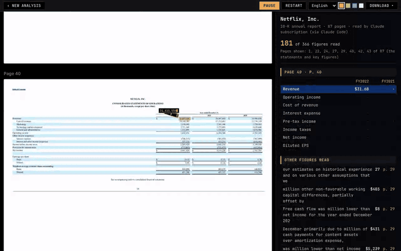
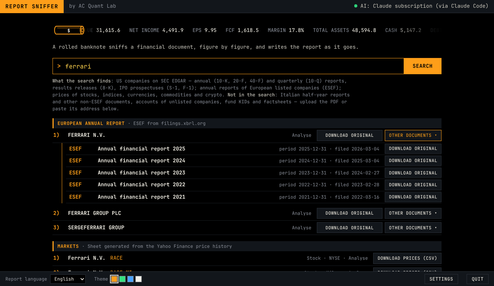
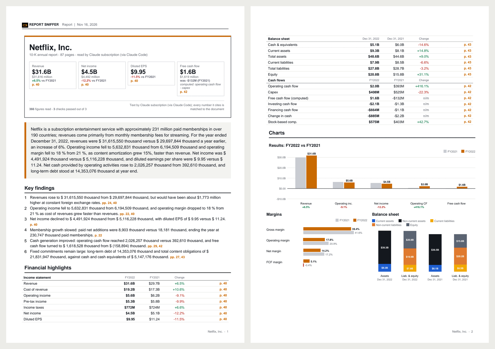

# Report Sniffer

*by AC Quant Lab*

Report Sniffer reads financial documents (10-K, ESEF, PDFs, market data) and builds a live, cited report in a
terminal-style interface. Runs locally on macOS, Windows and Linux in a Chromium browser. Free and open source under the
[MIT license](LICENSE).



An AI reads every document first — what it is, how the business works, the results, the risks, the offering — and
the sniffer, a small rolled banknote, then goes over the pages that hold what it found and
selects the figures one by one. Every number the AI writes is checked against the page it comes from.

The interface is in English, or in Italian when the operating system's language is Italian (`SNIFFER_LANG=en` or
`SNIFFER_LANG=it` forces one). The report can be produced in English or Italian; it starts in the interface language.

## Screenshots

Netflix's 2022 10-K (FinanceBench PDF), read by a Claude subscription through Claude Code; the texts are the AI's
own, unedited.

| | |
|---|---|
|  |  |
| **Reading** — every figure is selected, underlined and lands in the report with its page. | **The card** — headline figures, findings and checks, each citing its page. |
|  |  |
| **Search** — annual reports, quarterly reports and earlier years, to analyse or download. | **PowerPoint** — editable charts and tables, every slide names its source pages. |



**PDF report** — the same analysis on paper; the figures are also downloadable as an Excel workbook.

## Download

Get the app for your system from the [latest release](../../releases/latest), unpack it and double-click it.
No Python and no terminal are needed.

| System | File | Start |
|---|---|---|
| Windows 10/11 (64-bit) | `ReportSniffer-windows-x64.zip` | unpack, open the `ReportSniffer` folder, double-click `ReportSniffer.exe` |
| macOS (Apple silicon) | `ReportSniffer-macos-arm64.zip` | unpack, move `Report Sniffer.app` to Applications, double-click it |
| Linux (x86-64, glibc 2.39+) | `ReportSniffer-linux-x64.tar.gz` | unpack, run `ReportSniffer/ReportSniffer` |

The app has no window of its own: it opens `http://127.0.0.1:8765` in a Chromium-based browser and, the first
time, asks you to connect an AI. It keeps running until you press **Quit** in the bottom bar of the home page;
starting it again while it runs just reopens the page. What it would print goes to `~/.report-sniffer/app.log`.

- The builds are **not code-signed**. On macOS the first start is blocked ("cannot be verified"): go to
  *System Settings → Privacy & Security* and click *Open Anyway*. Windows shows "Windows protected your PC":
  click *More info → Run anyway*.
- Intel Macs and other systems: run it from the source (below).
- The apps are built by GitHub Actions (`.github/workflows/build.yml`) whenever a tag `v…` is pushed.

## Requirements

- **A Chromium-based browser**: Chrome, Brave, Edge, Arc, Vivaldi or Opera.
  **Safari and Firefox are not supported** — the page loads but the document is not read.
  The app opens a Chromium browser on its own (your default one if it is Chromium-based).
- macOS, Windows or Linux.
- **An AI** (asked on the first start, required): your Claude Pro/Max or ChatGPT subscription, or an API key — see
  [The AI](#the-ai-required).
- Only to run from the source: **Python 3.10 or newer** — [python.org/downloads](https://www.python.org/downloads/)
  (on Windows tick *Add python.exe to PATH*; on a Mac `brew install python` also works).

## Run from the source

| System | Double-click | Or from a terminal, in the project folder |
|---|---|---|
| macOS / Linux | `Start Report Sniffer.command` | `python3 launch.py` |
| Windows | `Start Report Sniffer.bat` | `py launch.py` |

The first start creates a virtual environment (`.venv`), installs the dependencies (1–2 minutes) and asks for a
name and email to identify yourself to the SEC (optional). Then the app opens at `http://127.0.0.1:8765` and, the first time, asks you to connect an AI.
Close the terminal window (or press Ctrl+C, or **Quit** on the home page) to stop it.

- **macOS blocks the double-click** ("cannot be verified"): use `python3 launch.py` from Terminal, or go to
  *System Settings → Privacy & Security*, click *Open Anyway* at the bottom and try again.
- **Windows shows "Windows protected your PC"**: click *More info → Run anyway*, or use `py launch.py`.
- Options (also for the downloaded app): `SNIFFER_PORT=9000` changes the port, `SNIFFER_LANG=en|it` forces the interface language, `SNIFFER_BROWSER="Brave Browser"` (macOS app name, or an
  executable path elsewhere) forces a browser, `--no-browser` starts only the server.
- To build the app yourself: `pip install -r requirements.txt pyinstaller`, then
  `pyinstaller --noconfirm packaging/report_sniffer.spec` (the result is in `dist/`).

## What it reads

| You look for | The document that is read | Source |
|---|---|---|
| US-listed companies (MSFT, NVDA, …) | Latest 10-K, 20-F or 40-F in inline XBRL; under *Other documents* the quarterly reports (10-Q), results releases (8-K item 2.02, read from exhibit 99.1), prospectuses and earlier years | SEC EDGAR |
| Companies before an IPO (no ticker yet) | Latest S-1, F-1 or 424B prospectus (tagged or not) | SEC EDGAR full-text search |
| European companies (Ferrari, ENI, …) | ESEF annual report in inline XBRL; earlier years under *Other documents* | filings.xbrl.org |
| Crypto, indices, currencies, commodities, ETFs, funds (BTC-USD, ^GSPC, EURUSD=X, GC=F, …) | A generated market sheet: chart, calendar-year and monthly returns, volatility, drawdowns | Yahoo Finance (Coinbase as fallback for crypto) |
| Any other document, in English or Italian: annual report or statements as PDF/HTML, KID, prospectus, factsheet, whitepaper | The file you upload (*Upload a document*) or the URL you paste | Your file / URL |

**Not in the search** (the home page says so too): Italian half-year reports and other documents not filed in ESEF, accounts of
unlisted companies (business register), fund KIDs and factsheets — upload the PDF or paste its address.

Companies without a ticker are found through EDGAR full-text search among the filers of prospectuses and annual
reports. Each search result offers two actions: **Analyse** (the document is read) or **Download original** — the filing as
published on SEC EDGAR (`.htm`), the ESEF report from filings.xbrl.org (`.xhtml`), or for market instruments the
daily price history as CSV.

In inline XBRL filings every figure is an XBRL tag, so its value and exact position are known — no guessing.
In untagged PDF/HTML the figures are the ones printed on the page:

- **Pages**: HTML filings are split into their printed pages — page breaks, or the fixed-size page boxes of EDGAR's
  PDF-to-HTML renderings (an S-1 of 400+ pages included); EDGAR submission envelopes (`<DOCUMENT><TYPE>S-1…`) are
  removed. Citations use the page numbers printed on the page ("p. 22", "p. F-7").
- **Tables**: statement tables are read as tables: every cell gets its row and its column, and the column header
  gives the period — "Year Ended December 31, 2025", "Six Months Ended June 30, 2026", "As of June 30, 2026";
  "$ Change", "% Change", "Pro Forma" and "As Adjusted" columns are left out, percentage-of-revenue tables are
  marked as percentages, the scale comes from "(in millions…)" (share counts "in thousands" too).
- **Periods**: the current period is the latest one (an interim period when there is one) and it is compared with
  the same period a year earlier; balance sheet items with the latest date and the previous year end. The same line
  printed in the summary, the MD&A and the statements is counted once.
- **Rows**: Revenue / Ricavi, Net income or Net loss / Utile netto, "Net loss per share…, basic and diluted",
  Operating loss, Loss before provision for income taxes, Total operating expenses, Redeemable convertible preferred
  stock, Total stockholders' deficit, Net cash provided by (used in) operating / investing / financing activities,
  Purchases of property and equipment, Net increase in cash…
- **Not figures**: days in dates ("June 30"), footnote marks ("Net loss(2)", "(Note 13)"), par values, phone
  numbers and ZIP codes are skipped.
- In PDFs the rows are recognised from their labels on the page with the column periods and scale: years in either
  order (2022 2023 2024 or the reverse), quarter codes (1Q23 vs 1Q22), "Three Months Ended", "Thirteen Weeks Ended",
  "Second Quarter", dates printed on a line of their own; note-reference and "% to sales" columns are left out, labels
  wrapped onto two lines are joined, the consolidated statements win over the parent-company ones and over segment
  tables. Statement lines no rule knows are recognised by the AI, whose values are checked against the page before
  they feed the card, checks and charts.
- **Banks and insurers**: net interest and other banking income, total net revenue, insurance revenue (IFRS 17) count
  as revenue; free cash flow is not computed for them (capex means little for a bank's cash flow statement).
- **ESEF reports** laid out with page containers (`pf`, `page…` classes, nested) or with no pages at all (the text
  is cut into pages at headings) are split too; issuer-specific concepts are recognised by the label of their row.

## Report

- **What the AI understood**: the kind of document, a short summary and the key points by theme (business, results,
  cash, risks, offering, ownership…), each with its pages — in the side panel at the end of the reading and in the PDF.
- **Card (financial statements)**: revenue, net income (or net loss), diluted EPS, free cash flow (operating cash flow −
  capex, marked as computed), each with the exact amount, the change against the comparative period ("+1,300% vs
  H1 2025") — or the comparative value when a loss makes a percentage meaningless — and the page.
- **Arithmetic checks**, only those the figures allow: revenue − operating expenses = operating income;
  pre-tax income − taxes = net income; assets = liabilities (+ redeemable preferred stock) + equity; diluted EPS ×
  diluted shares ≈ net income; operating + investing + financing cash flows (+ exchange rates, + cash moved to assets
  held for sale) ≈ change in cash; gross profit = revenue − cost of revenue. A gap that other lines explain (amortisation
  between gross profit and costs, an exchange-rate line not read) is shown with its amount and the reason, not as a
  pass. When no check is possible the report says so; it never calls figures "verified" without a check.
- **Findings**: growth, margins, cash conversion, shareholder returns, interest coverage, debt due vs cash,
  liquidity, leverage — deterministic calculations on the document's figures.
- **Language**: Italian or English, chosen on the home page or while reading (the report is regenerated:
  findings, checks, labels, number formats — `$120B` / `$120 mld`).
- **Download** (menu in the reading view): *Report (PDF)*; *Slides (PowerPoint)* — a 16:9 deck with native, editable charts,
  every slide citing the printed pages and the source; *Figures (Excel)* — statements as numbers with unit and page, changes
  and free cash flow as formulas, ratios, checks, every figure read (prices and returns for market sheets).
  The PDF is drawn on white, with the accent colour of the chosen theme, by the local server
  in a fraction of a second (no browser involved). No pages of raw figures: it holds
  - the summary card, the AI's summary and the key findings;
  - **financial highlights**: income statement, balance sheet and cash flows with the two periods compared, the change
    and the page of each line;
  - charts: revenue and net income over every period the document prints (years, then the latest interim pair),
    results against the comparative period, margins, balance sheet (side by side when there is a deficit or
    redeemable preferred stock), where the operating cash goes; for market sheets the price chart, calendar-year
    returns, drawdown and the monthly-returns heatmap;
  - what the AI understood section by section, key ratios, the arithmetic checks with their pages, and how the
    document was read (pages shown, pages the AI read, periods compared).
- **Themes**: Terminal (amber on black, the default), Phosphor (green), Desk (blue) and Paper (light) — the swatches
  in the bottom bar of the home page and in the reading bar change the interface, the sniffer, the highlights and
  the accent colour of the PDF and the slides; the choice is remembered in the browser.

## The sniffer

A small rolled banknote lying on its side, drawn with a few thin lines. Its nose stops at the left edge of each
figure, on its line. The figure is selected as in a terminal: the highlight steps over it one character at a time
behind a caret, stays while the figure is read, then settles into a thin underline (a slightly stronger one for the
headline figures); at the same time the figure is typed out, with a block cursor, in a small readout above the roll.
Headings are selected the same way in the second colour. The roll glides from figure to figure with eased movements, left to right and down the
page; there are no boxes and nothing flashes.

It always reads **every** figure on the pages it opens and adapts its pace to how many there are (about
7 seconds for a short document, up to about 35 seconds for a long one); the headline figures (revenue, net income,
EPS, operating cash flow) stay selected for at least half a second, however fast it goes. The "N of M figures read" counter counts
the figures on those pages, and the panel lists which pages of the document were read (the cover and the pages
with the financial statements and the key figures).

## The AI (required)

The first time the page opens it asks how to connect an AI, and checks that it answers. Two ways:

**A subscription you already have.** Report Sniffer runs the vendor's official command-line tool, which you install
and sign in to yourself; the app never sees or stores your credentials, and the usage counts toward your plan's limits.

| Subscription | Tool | Set up once |
|---|---|---|
| Claude Pro / Max | [Claude Code](https://claude.com/product/claude-code) | install it, run `claude`, sign in with your Claude account |
| ChatGPT Plus / Pro | [Codex CLI](https://github.com/openai/codex) | `npm install -g @openai/codex`, run `codex`, choose *Sign in with ChatGPT* |

The tool runs with no tools enabled (Claude Code: `--tools ""`) or in a read-only sandbox (Codex), in an empty
folder, and must return JSON that matches the expected schema.

> Terms: Anthropic's [Claude Code legal page](https://code.claude.com/docs/en/legal-and-compliance) says that
> third-party developers may not "route requests through Free, Pro, or Max plan credentials on behalf of their users",
> while it does not prevent an end user from signing in to the unmodified Claude Code binary with their own
> subscription. Report Sniffer does the latter (your own Claude Code, your own account, on your computer), but whether
> this kind of use fits your plan is for you to judge; Anthropic advises an API key for products built on Claude. If
> in doubt, use an API key.

**An API key** (billed by the provider to your account):

| Provider | Default model (editable) | Key from |
|---|---|---|
| Anthropic (Claude) | `claude-opus-5-5` | console.anthropic.com · `ANTHROPIC_API_KEY` |
| OpenAI | `gpt-5` | platform.openai.com · `OPENAI_API_KEY` |
| Google Gemini | `gemini-2.5-pro` | aistudio.google.com · `GEMINI_API_KEY` |
| Mistral | `mistral-large-latest` | console.mistral.ai · `MISTRAL_API_KEY` |
| xAI (Grok) | `grok-4` | console.x.ai · `XAI_API_KEY` |
| DeepSeek | `deepseek-chat` | platform.deepseek.com · `DEEPSEEK_API_KEY` |
| OpenRouter (any model it offers) | `openrouter/auto` | openrouter.ai · `OPENROUTER_API_KEY` |

**What the AI gets and what is checked.** The text of the pages — all of them when they fit in about 65k tokens,
otherwise the cover, the summary sections (prospectus summary, risk factors, MD&A, use of proceeds…) and the pages
densest with financial figures — plus, for XBRL filings, the tagged figures already read. It returns the kind of
document, a summary, key points by theme, up to 30 important figures with their page, and findings. A figure is kept
only if its value is printed on the page it cites; a sentence is kept only if each of its numbers is printed in the
pages read (a finding: in the figures it cites). So the report never shows numbers the document does not contain.
If the AI fails (network, limits), the reading goes on with the rule-based extraction and the report says so.

Keys and the choice of provider are stored in `~/.report-sniffer/ai.json` (readable only by you) or read from the
environment variables above.

## Data and privacy

The server listens on `127.0.0.1` only. Documents and responses are cached in `.data/` (in `~/.report-sniffer/data/` by the downloaded app). The SEC identity is in
`~/.report-sniffer/config.json`; the default is generic and no email is sent unless you enter one.

## Known limits

- A document already read is kept in `.data/` (`~/.report-sniffer/data/` for the downloaded app); after an update of Report Sniffer it is read again (the cache key
  includes the version of the reading).
- The AI reading takes from a few seconds to a couple of minutes for a long prospectus, and costs what the provider
  charges for about 65k input tokens (or counts toward your subscription's limits). Each report language is a new reading.
- Financial figures depend on the issuer's tags: rare or custom concepts may be missing (the card shows "—").
- Documents up to 400 MB (a large ESEF report such as Enel's is 130 MB and takes about 10 s and 700 MB of memory).
  filings.xbrl.org and SEC EDGAR answer "busy" (HTTP 429/503) at times: the app waits and retries three times.
- Untagged PDFs are read from their layout: a statement printed as an image (a scan) has no text to read, and an
  unusual layout can leave a line unread or take it from another table; the page of every figure is shown so it can
  be checked. Checked on 44 real SEC filings and earnings releases (FinanceBench) and 21 ESEF reports. A diluted EPS row labelled only by a section header above it ("Earnings per share — diluted:")
  is often left to the AI.
- Free cash flow uses capex on property, plant and equipment; some companies also include intangibles.
- Yahoo Finance has no official API. It rejects clients that do not look like a browser (HTTP 429), so the app
  talks to it through `curl_cffi`, which presents itself as Chrome, with a session cookie and both hosts. For crypto
  pairs (BTC-USD, ETH-EUR, …) the price history falls back to Coinbase's public API if Yahoo is still unavailable;
  for indices, currencies and commodities Yahoo is the only source, so try again a few minutes later.

## Project layout

```
app.py                        entry point of the downloadable app (server in-process, browser, no terminal)
packaging/                    PyInstaller recipe and icon of the app; .github/workflows/build.yml builds it
launch.py                     launcher to run from the source (venv, dependencies, server, Chromium browser)
Start Report Sniffer.command  macOS/Linux double-click wrapper
Start Report Sniffer.bat      Windows double-click wrapper
server.py                     FastAPI server (localhost only)
analyst/                      sources, iXBRL parser, tables, financials, statements, market sheet, PDF/HTML, AI providers and reader, PDF report, charts and themes, i18n
web/                          interface, sniffer animation, live report
tests/                        offline tests on synthetic documents and simulated APIs
```

## Tests

```
.venv/bin/pip install pytest reportlab        # Windows: .venv\Scripts\pip install pytest reportlab
.venv/bin/python -m pytest -q
```

The tests use synthetic documents (made-up companies and numbers) and simulated SEC, filings.xbrl.org and Yahoo
responses; they need no network.

## License

[MIT](LICENSE) © 2026 AC Quant Lab. Report Sniffer is not financial advice.
